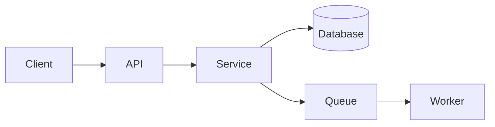

# software-docs-suite — Reference Bundle

This file bundles several reference documents into one, separated by clear headers, so they fit ChatGPT's knowledge file-count limit per Custom GPT / Project.

---


## FILE: references/agent-instructions.md

# Agent Instructions Guide

Use this to write the `AGENTS.md` file that ships inside the suite. `AGENTS.md` is the operating
manual the AI coding agent reads first and obeys throughout the build. It is what turns a pile of
specs into something an agent can execute reliably.

Copy the template below into the suite's `AGENTS.md`, then tailor the bracketed parts to the
project's stack, conventions, and the specific skills/tools the consuming agent has available.

---

## Skill-selection guidance (how to fill the "which skill to use" parts)

Throughout `AGENTS.md` and `08-build-plan.md`, tell the agent *which concrete capability to reach for*
rather than leaving it to guess. Map task kinds to tools:

- **Producing office files** (Word/Excel/PowerPoint/PDF output as a product feature or deliverable) →
  the corresponding document skill (docx, xlsx, pptx, pdf).
- **Front-end / UI work** → the project's chosen framework, plus any design skill or design-tool
  connector (e.g. Figma) named in `05-ui-ux.md` so layout comes from real specs.
- **Scaffolding / running code** → the stack's standard CLI (package manager, project generator,
  migration tool, test runner) — name the exact commands.
- **Testing** → the project's test framework and the commands in `07-testing-strategy.md`.
- **External services / data** → the relevant connector or API client, with auth handled per
  `06-security.md`.

If the consuming agent has a skill registry, instruct it to consult the skill list when a task
matches a known skill's trigger, and to prefer a purpose-built skill over ad-hoc code. If you don't
know what skills the agent has, phrase it capability-first ("use your spreadsheet-generation
capability") so it maps regardless of the toolset — this keeps the suite portable across Claude Code,
IDE agents, and tool-agnostic agents.

---

## AGENTS.md template

```markdown
# AGENTS.md — Operating Manual for the AI Development Agent

You are building <Product Name>. This file is your standing instruction set. Follow it for every
task. When this file and a specific doc disagree, the specific doc wins for that detail; when in
doubt about process, this file wins.

## 1. Before you write any code
- Read `README.md`, then this file, then `00`–`07`, then `08-build-plan.md`.
- Build strictly from `08-build-plan.md`, in order. Do not skip ahead of unmet dependencies.
- If anything is ambiguous or missing, do NOT invent product behavior. Record it as a `[TODO]` in the
  relevant doc and either ask or proceed with a clearly-marked `[ASSUMPTION]` — never a silent guess.

## 2. Coding standards
- Language/style: <formatter, linter, style guide, naming conventions>.
- Structure: follow the repository layout in `02-architecture.md`. Put things where the docs say.
- Cross-cutting conventions (config, logging, error handling) per `02-architecture.md`. Reuse them;
  don't reinvent per file.
- Commits: small and scoped; one logical change per commit; message says what and why.
- Never commit secrets. Config via env vars per `06-security.md`.

## 3. The build loop (run for EVERY task)
1. Read the task in `08-build-plan.md` and its referenced spec sections.
2. Implement the smallest correct version that satisfies the acceptance criteria.
3. Write tests for the new behavior — happy path AND unhappy path — per `07-testing-strategy.md`.
4. Run the focused tests → fix until green. Don't weaken a test to pass it.
5. Run the full suite + lint + typecheck + build. All must pass (no regressions).
6. Verify end to end at the real boundary (call the endpoint / drive the UI / run the script against
   realistic data) and confirm the observable result matches the acceptance criteria.
7. Tick the task's Definition of Done; update `CHANGELOG.md`.
8. Only then start the next task.

A task is DONE only when steps 3–7 are all satisfied. Green unit tests alone are not "done."

## 4. Which skill/tool to use
<Fill from the skill-selection guidance: map the project's task kinds to concrete skills/tools/
commands. Tell the agent to prefer a purpose-built skill over ad-hoc code, and to consult its skill
list when a task matches a skill's trigger.>

## 5. Decisions
Any non-trivial technical choice → add an ADR in `decisions/` (use `assets/adr-template.md`) before
implementing. Don't silently re-decide something an existing ADR already settled.

## 6. When you're blocked
- Missing dependency/tool: stop, note it, surface it — don't fake around it.
- Ambiguous requirement: mark `[TODO]`, pick the lowest-risk interpretation, flag it for the user.
- A test reveals the spec is wrong: fix the spec (and its ADR) first, then the code, then the test.
- Never delete or skip a failing test to make the build green.

## 7. Definition of Done (global)
The product is done when: all build-plan tasks are complete; every functional requirement traces to a
passing test; coverage gates in `07-testing-strategy.md` are met; lint/typecheck/build/CI are green;
and the system has been verified end to end against the acceptance criteria in `01-requirements.md`.
```

---

## Notes for tailoring

- Keep `AGENTS.md` short and imperative — it's read every task; bloat gets skimmed.
- Make the standing rules match the project's real tooling. A rule the agent can't follow (a command
  that doesn't exist, a skill it doesn't have) erodes trust in the whole file.
- The two rules that matter most, stated plainly: **build in order from the plan**, and **not done
  until tested and verified end to end**. Everything else supports those.


---


## FILE: references/document-templates.md

# Document Templates

Exact structure for every document in the suite. Fill every section; delete a section only if it is
truly non-applicable and note why. Keep the numbered filenames — they define the agent's reading
order. Worked mini-examples use a generic "TaskFlow" (a team task-tracking SaaS) for illustration.

## Table of contents
1. README.md
2. 00-product-brief.md
3. 01-requirements.md
4. 02-architecture.md
5. 03-data-model.md
6. 04-api-spec.md
7. 05-ui-ux.md
8. 06-security.md
9. 07-testing-strategy.md (structure only — full guidance in `testing-and-verification.md`)
10. 08-build-plan.md
11. 09-deployment-ops.md
12. glossary.md, CHANGELOG.md
13. Completeness checklist

---

## 1. README.md

The suite's front door. Orients a human and, more importantly, an agent.

```markdown
# <Product Name> — Documentation Suite

<One-paragraph description of the product and what this suite is for.>

## How to use this suite (for AI agents)
Read in this order before writing any code:
1. `AGENTS.md` — your operating manual and standing rules.
2. `README.md` (this file) — the map.
3. `00-product-brief.md` → `07-testing-strategy.md` — the spec.
4. `08-build-plan.md` — your ordered task list. Build from here.

Rules: follow `AGENTS.md` at all times. A task is done only when its tests pass and the change is
verified end to end. Record every significant decision as an ADR in `decisions/`.

## Document index
| File | Purpose |
|------|---------|
| 00-product-brief.md | Why we're building this and for whom |
| 01-requirements.md | What it must do, with acceptance criteria |
| ... | ... |

## Status
Mode: <greenfield | brownfield>. Last updated: <date>.
Legend: [ASSUMPTION] chosen default · [TODO] open question · [INFERRED] read from code, unconfirmed.
```

---

## 2. 00-product-brief.md

```markdown
# Product Brief

## Problem
<The concrete problem, and evidence it matters.>

## Target users
<Primary and secondary personas: who they are, their context, their pain.>

## Jobs to be done
<The core jobs users hire this product for, as outcome statements.>

## Success metrics
<3–5 measurable outcomes with targets, e.g. "median task-creation time < 5s".>

## Scope — MVP
<Bulleted list of what ships in the first buildable version.>

## Out of scope (explicitly)
<What we are deliberately NOT building now. This bounds the agent.>

## Constraints & assumptions
<Stack/hosting/budget/compliance/deadlines. Mark chosen defaults [ASSUMPTION].>
```

Mini-example (jobs to be done): "As a team lead, capture a task in under 5 seconds without leaving
the current screen, so nothing is lost during standup."

---

## 3. 01-requirements.md

```markdown
# Requirements

## Functional requirements
Grouped by capability. Each requirement has an ID, a user story, and testable acceptance criteria.

### FR-1 <Capability name>
**Story:** As a <role>, I want <capability>, so that <benefit>.
**Acceptance criteria:**
- Given <context>, when <action>, then <observable result>.
- <edge case / error case behavior — required, not optional>.

## Non-functional requirements
| ID | Category | Requirement (measurable) |
|----|----------|--------------------------|
| NFR-1 | Performance | p95 API latency < 300ms at 100 rps |
| NFR-2 | Availability | 99.5% monthly uptime |
| NFR-3 | Security | All PII encrypted at rest; see 06-security.md |

## Traceability
Every FR maps to build-plan task(s) and test(s). Keep this table current.
| Requirement | Build task(s) | Test(s) |
```

Rule: if an acceptance criterion can't be turned into a test, it's underspecified — rewrite it until
it can. Always include the unhappy path (invalid input, auth failure, empty state, limits).

---

## 4. 02-architecture.md

```markdown
# Architecture

## Overview
<2–4 sentences: shape of the system and the driving forces behind the design.>

## Component diagram (as text)
Use a Mermaid block or an ASCII diagram — text so it lives in version control.


## Components
For each component: responsibility, inputs/outputs, key dependencies, and where it lives in the repo.

## Tech stack (with rationale)
| Layer | Choice | Why | ADR |
|-------|--------|-----|-----|
| Language/runtime | ... | ... | decisions/0001 |
| Framework | ... | ... | ... |
| Datastore | ... | ... | ... |

## Cross-cutting concerns
Config, logging, error handling, background jobs, caching, i18n — the conventions every component
follows. The agent should treat these as house rules.

## Repository layout
<The directory structure the agent should create/expect, with a one-line note per top-level dir.>
```

---

## 5. 03-data-model.md

```markdown
# Data Model

## Entities
For each entity: purpose + a field table.
### <Entity>
| Field | Type | Null? | Constraints | Notes |
|-------|------|-------|-------------|-------|
| id | uuid | no | PK | |
| ... | | | | |

## Relationships
<1:1 / 1:N / N:M, with FKs and cascade behavior. A text ER diagram helps.>

## Migrations
<Ordered migration steps, or the initial schema DDL. Note the migration tool.>

## Seed & fixture data
<Minimum data needed to run and demo locally, and the fixtures tests rely on. Without this the
agent can't produce a runnable system.>

## Data lifecycle
<Retention, soft vs. hard delete, PII handling — cross-link 06-security.md.>
```

---

## 6. 04-api-spec.md

```markdown
# API Specification

## Conventions
Base URL, versioning, content type, pagination, auth header, and the standard error envelope
(shape returned for every error).

## Endpoints
For every endpoint, fully specified:
### <Method> <path> — <name>
- **Auth:** <required scope/role, or public>
- **Request:** path/query params + body schema (types, required, constraints).
- **Responses:** each status code with its body schema and an example.
- **Errors:** the specific error codes this endpoint returns and when.
- **Example:** a concrete request → response pair.

## Error model
Enumerate error codes, HTTP status, meaning, and client remedy.
```

Mini-example:
```
### POST /v1/tasks — Create task
Auth: Bearer token, scope task:write
Request body: { "title": string(1..200, required), "assigneeId": uuid|null }
201 → { "id": uuid, "title": string, "status": "open", "createdAt": iso8601 }
422 → error envelope, code VALIDATION_FAILED, when title missing/too long
401 → code UNAUTHENTICATED
```
For REST-heavy systems, consider also emitting an OpenAPI file and referencing it here.

---

## 7. 05-ui-ux.md  (omit for headless/back-end-only products)

```markdown
# UI / UX

## Screens & flows
For each screen: purpose, the states it can be in (loading, empty, error, populated), key
components, and the actions available. Include the primary user flows as ordered steps.

## Component inventory
Reusable components with their props/variants and behavior.

## States & feedback
Loading, empty, error, success, and validation feedback rules — so the agent builds all states,
not just the happy path.

## Accessibility & responsiveness
Keyboard, contrast, semantics, breakpoints. Minimum bar the agent must meet.
```

If you have design references or a design tool available (e.g. a Figma or design skill), name it
here so the agent pulls real specs instead of inventing layout.

---

## 8. 06-security.md

```markdown
# Security

## Authentication
<Mechanism, token lifetime, refresh, storage.>

## Authorization
<Roles/scopes and the permission matrix: who can do what.>

## Secrets & config
<How secrets are provided and never committed. Reference env vars, not values.>

## Data protection
<Encryption at rest/in transit, PII fields, retention, redaction in logs.>

## Threat model
<Top threats (e.g. per STRIDE or OWASP Top 10) and the mitigation for each.>

## Compliance
<Any regime that applies (GDPR, SOC2, HIPAA…) and the concrete obligations it creates.>
```

---

## 9. 07-testing-strategy.md

Structure below; write the full content from `references/testing-and-verification.md`.

```markdown
# Testing Strategy

## Philosophy & pyramid
## Coverage gates (the numbers a task must hit to be "done")
## Test types (unit / integration / e2e / contract / other) — with when to use each
## How to write a good test (naming, arrange-act-assert, one behavior per test)
## How to run tests (exact commands per layer)
## The verify loop (how the agent confirms the software actually works before moving on)
## Test data & fixtures
## CI gate (what must pass before merge)
```

---

## 10. 08-build-plan.md

The ordered, agent-executable plan. This is what the agent works through.

```markdown
# Build Plan

Build in order. Do not start a task until its dependencies are done and verified. After each task,
update CHANGELOG.md and check off the Definition of Done.

## T-01 — <Task name>
- **Goal:** <one sentence outcome>
- **Depends on:** <task IDs, or "none">
- **Skill(s) to use:** <the concrete tool/skill/framework for this task; say "none needed" if plain code>
- **Steps:**
  1. ...
- **Tests to write:** <specific tests proving this task works — reference 07-testing-strategy.md>
- **Definition of Done:**
  - [ ] Feature works per its acceptance criteria (FR-x)
  - [ ] Tests written and passing
  - [ ] No regressions (full suite green)
  - [ ] Verified end to end (per the verify loop)
  - [ ] CHANGELOG.md updated
```

Mini-example:
```
## T-03 — Task CRUD API
Depends on: T-02 (data layer)
Skill(s) to use: the project's web framework; testing framework for integration tests
Steps: implement POST/GET/PATCH/DELETE /v1/tasks per 04-api-spec.md; wire validation + error envelope
Tests to write: integration tests for each endpoint incl. 422 validation and 401 auth paths
Definition of Done: all four endpoints match the spec exactly; integration tests green; no regressions
```

Sequencing guidance: foundation/scaffold → config/secrets → data layer + migrations → core domain
logic → API → UI → integrations → observability/hardening. Keep tasks small enough to finish and
verify in one focused pass.

---

## 11. 09-deployment-ops.md

```markdown
# Deployment & Operations

## Environments
<local / staging / prod: how each is configured and reached.>
## Build & CI/CD
<Pipeline stages; the gate that blocks a bad build. Cross-link the CI gate in 07.>
## Infrastructure
<Where it runs, provisioning, and any IaC.>
## Configuration
<Every env var / config key, its purpose, and default.>
## Observability
<Logs, metrics, traces, alerts — what "healthy" looks like.>
## Runbooks
<Deploy, rollback, and the top 2–3 incident responses as numbered steps.>
```

---

## 12. glossary.md & CHANGELOG.md

`glossary.md`: a table of domain terms and acronyms with definitions, so the agent names things
consistently across code and docs. `CHANGELOG.md`: Keep-a-Changelog style; the agent appends an
entry per completed build task.

---

## Completeness checklist

Run before delivery. The suite passes only if every box can be checked honestly.

- [ ] **Buildable cold:** a competent agent with no access to the user or chat could build the
      product from these files alone.
- [ ] Every functional requirement has testable acceptance criteria, including error/edge cases.
- [ ] Data model specifies types, nullability, constraints, keys, and seed/fixture data.
- [ ] Every API endpoint specifies auth, full request+response schemas, status codes, and errors.
- [ ] Every significant technical decision has an ADR in `decisions/`.
- [ ] `08-build-plan.md` is dependency-ordered with per-task skill assignment, tests, and a DoD that
      includes passing tests and verification.
- [ ] `07-testing-strategy.md` states coverage gates and the exact commands to run and verify tests.
- [ ] `AGENTS.md` gives standing rules, the build loop, skill-selection guidance, and the
      "not done until verified" rule.
- [ ] Security: auth, authz, secrets, and data handling are all specified.
- [ ] Docs are cross-linked; assumptions/TODOs/inferences are marked.
- [ ] (Brownfield) Docs match the actual code; inferred facts flagged `[INFERRED]`.


---


## FILE: references/testing-and-verification.md

# Testing & Verification Guide

Write `07-testing-strategy.md` from this file, adapting specifics (frameworks, commands, thresholds)
to the project's stack. The goal is not "tests exist" — it's that the agent can **prove the software
works** and knows exactly when a task is finished. Underspecified testing docs are the number-one
reason AI-built software looks done but isn't.

---

## Philosophy

- **A task is not done until its tests pass and the change is verified end to end.** State this in
  the docs and enforce it in every task's Definition of Done. It is the load-bearing rule.
- **Test behavior, not implementation.** Tests assert observable outcomes (return values, state
  changes, responses), so they survive refactors.
- **Every requirement traces to a test.** If a functional requirement has no test, it is not
  actually delivered. Keep the traceability table in `01-requirements.md` current.
- **Cover the unhappy path.** Invalid input, auth failures, empty/limit/boundary conditions, and
  concurrency where relevant — not just the happy path.

## The test pyramid

Specify the mix for this project. A typical shape:

- **Unit (most):** pure functions and single units in isolation. Fast, no I/O.
- **Integration (some):** units wired together with real adjacent dependencies (DB, in-process API).
- **End-to-end (few):** the whole system exercised as a user would, through its real entry points.
- **Contract (as needed):** verify API request/response shapes match `04-api-spec.md`; guards against
  drift between producer and consumer.

State roughly how many of each and why, given the product's risk profile.

## Coverage gates

Give concrete numbers so "done" is objective, e.g.:

- Overall line coverage ≥ 80%; core domain logic ≥ 90%.
- 0 known-failing tests on the main branch.
- Every new build-plan task adds tests for its new behavior (no untested code merged).

Coverage is a floor, not a goal — a green bar with meaningless assertions is worse than honest gaps.
Tell the agent to assert real outcomes, not just execute lines.

## Test types — when to use each

| Type | Use it to verify | Speed |
|------|------------------|-------|
| Unit | A single function/class behaves per spec, incl. edge cases | Fast |
| Integration | Components work together (e.g. API → service → DB) | Medium |
| E2E | A full user flow works through real entry points | Slow |
| Contract | API shapes match the spec exactly | Fast |
| Regression | A previously fixed bug stays fixed (add one per bug) | Varies |

## How to write a good test

- **Name states the behavior:** `create_task_rejects_empty_title`, not `test_task_1`.
- **Arrange → Act → Assert**, one behavior per test.
- **Deterministic:** no reliance on wall clock, network, or random unless seeded/mocked.
- **Independent:** any order, no shared mutable state; each test sets up and tears down its own data.
- **Meaningful assertions:** check the actual result and side effects, not just "no exception."

## How to run tests (fill in exact commands)

Give the literal commands for this stack so the agent runs them verbatim, e.g.:

```
# unit + integration
<test runner command>            # e.g. pytest -q   |   npm test   |   go test ./...   |   cargo test
# coverage
<coverage command>               # e.g. pytest --cov   |   npm run test:coverage
# e2e
<e2e command>
# lint / typecheck / build (also gates)
<lint> && <typecheck> && <build>
```

## The verify loop (the agent runs this to confirm real working)

This is the concrete loop the agent executes for every build-plan task before marking it done. Put
it verbatim in `07-testing-strategy.md` and reference it from `AGENTS.md`:

1. **Implement** the task per its spec.
2. **Write tests** for the new behavior (happy + unhappy paths) per this guide.
3. **Run the focused tests** for the change. Red → fix and repeat. Never edit a test just to make it
   pass unless the test itself is genuinely wrong.
4. **Run the full suite** to catch regressions. All green required.
5. **Run lint, typecheck, and build** — these are gates too.
6. **Verify end to end at the real boundary.** Don't trust green unit tests alone: actually exercise
   the feature the way a user/client would — call the running endpoint, drive the UI flow, run the
   CLI, or execute the script against realistic data — and confirm the observable outcome matches the
   acceptance criteria. For anything with a runnable surface, boot it and hit it.
7. **Check the Definition of Done** for the task; update `CHANGELOG.md`.
8. Only now move to the next task.

If a step can't be completed (missing dependency, ambiguous spec), stop and record a `[TODO]` /
blocker per `AGENTS.md` rather than faking a pass.

## Test data & fixtures

Point the agent at the seed/fixture data in `03-data-model.md`. Tests must create and clean up their
own data. Prefer factories/builders over copy-pasted literals so tests stay readable and maintainable.

## CI gate

Define the single gate that blocks a bad merge — typically: full test suite green **and** coverage
threshold met **and** lint/typecheck/build pass. If CI exists, wire these in `09-deployment-ops.md`.


---


## FILE: assets/adr-template.md

# NNNN — <Title of the decision>

- Status: proposed | accepted | superseded by ADR-XXXX
- Date: <YYYY-MM-DD>

## Context
<The forces at play, constraints, and the problem this decision resolves.>

## Options considered
- **Option A** — pros / cons
- **Option B** — pros / cons

## Decision
<The option chosen and the one-line reason.>

## Consequences
<What this makes easier or harder, and any follow-up work it creates.>


---
