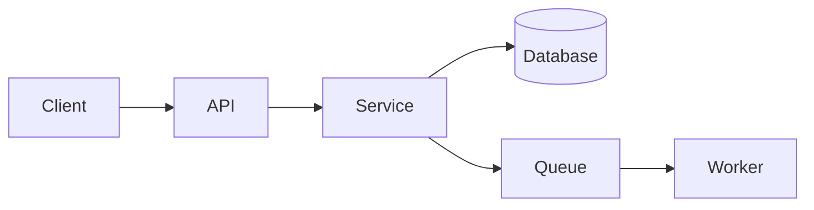

# Document Templates

Exact structure for every document in the suite. Fill every section; delete a section only if it is
truly non-applicable and note why. Keep the numbered filenames — they define the agent's reading
order. Worked mini-examples use a generic "TaskFlow" (a team task-tracking SaaS) for illustration.

## Table of contents
1. README.md
2. 00-product-brief.md
3. 01-requirements.md
4. 02-architecture.md
5. 03-data-model.md
6. 04-api-spec.md
7. 05-ui-ux.md
8. 06-security.md
9. 07-testing-strategy.md (structure only — full guidance in `testing-and-verification.md`)
10. 08-build-plan.md
11. 09-deployment-ops.md
12. glossary.md, CHANGELOG.md
13. Completeness checklist

---

## 1. README.md

The suite's front door. Orients a human and, more importantly, an agent.

```markdown
# <Product Name> — Documentation Suite

<One-paragraph description of the product and what this suite is for.>

## How to use this suite (for AI agents)
Read in this order before writing any code:
1. `AGENTS.md` — your operating manual and standing rules.
2. `README.md` (this file) — the map.
3. `00-product-brief.md` → `07-testing-strategy.md` — the spec.
4. `08-build-plan.md` — your ordered task list. Build from here.

Rules: follow `AGENTS.md` at all times. A task is done only when its tests pass and the change is
verified end to end. Record every significant decision as an ADR in `decisions/`.

## Document index
| File | Purpose |
|------|---------|
| 00-product-brief.md | Why we're building this and for whom |
| 01-requirements.md | What it must do, with acceptance criteria |
| ... | ... |

## Status
Mode: <greenfield | brownfield>. Last updated: <date>.
Legend: [ASSUMPTION] chosen default · [TODO] open question · [INFERRED] read from code, unconfirmed.
```

---

## 2. 00-product-brief.md

```markdown
# Product Brief

## Problem
<The concrete problem, and evidence it matters.>

## Target users
<Primary and secondary personas: who they are, their context, their pain.>

## Jobs to be done
<The core jobs users hire this product for, as outcome statements.>

## Success metrics
<3–5 measurable outcomes with targets, e.g. "median task-creation time < 5s".>

## Scope — MVP
<Bulleted list of what ships in the first buildable version.>

## Out of scope (explicitly)
<What we are deliberately NOT building now. This bounds the agent.>

## Constraints & assumptions
<Stack/hosting/budget/compliance/deadlines. Mark chosen defaults [ASSUMPTION].>
```

Mini-example (jobs to be done): "As a team lead, capture a task in under 5 seconds without leaving
the current screen, so nothing is lost during standup."

---

## 3. 01-requirements.md

```markdown
# Requirements

## Functional requirements
Grouped by capability. Each requirement has an ID, a user story, and testable acceptance criteria.

### FR-1 <Capability name>
**Story:** As a <role>, I want <capability>, so that <benefit>.
**Acceptance criteria:**
- Given <context>, when <action>, then <observable result>.
- <edge case / error case behavior — required, not optional>.

## Non-functional requirements
| ID | Category | Requirement (measurable) |
|----|----------|--------------------------|
| NFR-1 | Performance | p95 API latency < 300ms at 100 rps |
| NFR-2 | Availability | 99.5% monthly uptime |
| NFR-3 | Security | All PII encrypted at rest; see 06-security.md |

## Traceability
Every FR maps to build-plan task(s) and test(s). Keep this table current.
| Requirement | Build task(s) | Test(s) |
```

Rule: if an acceptance criterion can't be turned into a test, it's underspecified — rewrite it until
it can. Always include the unhappy path (invalid input, auth failure, empty state, limits).

---

## 4. 02-architecture.md

```markdown
# Architecture

## Overview
<2–4 sentences: shape of the system and the driving forces behind the design.>

## Component diagram (as text)
Use a Mermaid block or an ASCII diagram — text so it lives in version control.


## Components
For each component: responsibility, inputs/outputs, key dependencies, and where it lives in the repo.

## Tech stack (with rationale)
| Layer | Choice | Why | ADR |
|-------|--------|-----|-----|
| Language/runtime | ... | ... | decisions/0001 |
| Framework | ... | ... | ... |
| Datastore | ... | ... | ... |

## Cross-cutting concerns
Config, logging, error handling, background jobs, caching, i18n — the conventions every component
follows. The agent should treat these as house rules.

## Repository layout
<The directory structure the agent should create/expect, with a one-line note per top-level dir.>
```

---

## 5. 03-data-model.md

```markdown
# Data Model

## Entities
For each entity: purpose + a field table.
### <Entity>
| Field | Type | Null? | Constraints | Notes |
|-------|------|-------|-------------|-------|
| id | uuid | no | PK | |
| ... | | | | |

## Relationships
<1:1 / 1:N / N:M, with FKs and cascade behavior. A text ER diagram helps.>

## Migrations
<Ordered migration steps, or the initial schema DDL. Note the migration tool.>

## Seed & fixture data
<Minimum data needed to run and demo locally, and the fixtures tests rely on. Without this the
agent can't produce a runnable system.>

## Data lifecycle
<Retention, soft vs. hard delete, PII handling — cross-link 06-security.md.>
```

---

## 6. 04-api-spec.md

```markdown
# API Specification

## Conventions
Base URL, versioning, content type, pagination, auth header, and the standard error envelope
(shape returned for every error).

## Endpoints
For every endpoint, fully specified:
### <Method> <path> — <name>
- **Auth:** <required scope/role, or public>
- **Request:** path/query params + body schema (types, required, constraints).
- **Responses:** each status code with its body schema and an example.
- **Errors:** the specific error codes this endpoint returns and when.
- **Example:** a concrete request → response pair.

## Error model
Enumerate error codes, HTTP status, meaning, and client remedy.
```

Mini-example:
```
### POST /v1/tasks — Create task
Auth: Bearer token, scope task:write
Request body: { "title": string(1..200, required), "assigneeId": uuid|null }
201 → { "id": uuid, "title": string, "status": "open", "createdAt": iso8601 }
422 → error envelope, code VALIDATION_FAILED, when title missing/too long
401 → code UNAUTHENTICATED
```
For REST-heavy systems, consider also emitting an OpenAPI file and referencing it here.

---

## 7. 05-ui-ux.md  (omit for headless/back-end-only products)

```markdown
# UI / UX

## Screens & flows
For each screen: purpose, the states it can be in (loading, empty, error, populated), key
components, and the actions available. Include the primary user flows as ordered steps.

## Component inventory
Reusable components with their props/variants and behavior.

## States & feedback
Loading, empty, error, success, and validation feedback rules — so the agent builds all states,
not just the happy path.

## Accessibility & responsiveness
Keyboard, contrast, semantics, breakpoints. Minimum bar the agent must meet.
```

If you have design references or a design tool available (e.g. a Figma or design skill), name it
here so the agent pulls real specs instead of inventing layout.

---

## 8. 06-security.md

```markdown
# Security

## Authentication
<Mechanism, token lifetime, refresh, storage.>

## Authorization
<Roles/scopes and the permission matrix: who can do what.>

## Secrets & config
<How secrets are provided and never committed. Reference env vars, not values.>

## Data protection
<Encryption at rest/in transit, PII fields, retention, redaction in logs.>

## Threat model
<Top threats (e.g. per STRIDE or OWASP Top 10) and the mitigation for each.>

## Compliance
<Any regime that applies (GDPR, SOC2, HIPAA…) and the concrete obligations it creates.>
```

---

## 9. 07-testing-strategy.md

Structure below; write the full content from `references/testing-and-verification.md`.

```markdown
# Testing Strategy

## Philosophy & pyramid
## Coverage gates (the numbers a task must hit to be "done")
## Test types (unit / integration / e2e / contract / other) — with when to use each
## How to write a good test (naming, arrange-act-assert, one behavior per test)
## How to run tests (exact commands per layer)
## The verify loop (how the agent confirms the software actually works before moving on)
## Test data & fixtures
## CI gate (what must pass before merge)
```

---

## 10. 08-build-plan.md

The ordered, agent-executable plan. This is what the agent works through.

```markdown
# Build Plan

Build in order. Do not start a task until its dependencies are done and verified. After each task,
update CHANGELOG.md and check off the Definition of Done.

## T-01 — <Task name>
- **Goal:** <one sentence outcome>
- **Depends on:** <task IDs, or "none">
- **Skill(s) to use:** <the concrete tool/skill/framework for this task; say "none needed" if plain code>
- **Steps:**
  1. ...
- **Tests to write:** <specific tests proving this task works — reference 07-testing-strategy.md>
- **Definition of Done:**
  - [ ] Feature works per its acceptance criteria (FR-x)
  - [ ] Tests written and passing
  - [ ] No regressions (full suite green)
  - [ ] Verified end to end (per the verify loop)
  - [ ] CHANGELOG.md updated
```

Mini-example:
```
## T-03 — Task CRUD API
Depends on: T-02 (data layer)
Skill(s) to use: the project's web framework; testing framework for integration tests
Steps: implement POST/GET/PATCH/DELETE /v1/tasks per 04-api-spec.md; wire validation + error envelope
Tests to write: integration tests for each endpoint incl. 422 validation and 401 auth paths
Definition of Done: all four endpoints match the spec exactly; integration tests green; no regressions
```

Sequencing guidance: foundation/scaffold → config/secrets → data layer + migrations → core domain
logic → API → UI → integrations → observability/hardening. Keep tasks small enough to finish and
verify in one focused pass.

---

## 11. 09-deployment-ops.md

```markdown
# Deployment & Operations

## Environments
<local / staging / prod: how each is configured and reached.>
## Build & CI/CD
<Pipeline stages; the gate that blocks a bad build. Cross-link the CI gate in 07.>
## Infrastructure
<Where it runs, provisioning, and any IaC.>
## Configuration
<Every env var / config key, its purpose, and default.>
## Observability
<Logs, metrics, traces, alerts — what "healthy" looks like.>
## Runbooks
<Deploy, rollback, and the top 2–3 incident responses as numbered steps.>
```

---

## 12. glossary.md & CHANGELOG.md

`glossary.md`: a table of domain terms and acronyms with definitions, so the agent names things
consistently across code and docs. `CHANGELOG.md`: Keep-a-Changelog style; the agent appends an
entry per completed build task.

---

## Completeness checklist

Run before delivery. The suite passes only if every box can be checked honestly.

- [ ] **Buildable cold:** a competent agent with no access to the user or chat could build the
      product from these files alone.
- [ ] Every functional requirement has testable acceptance criteria, including error/edge cases.
- [ ] Data model specifies types, nullability, constraints, keys, and seed/fixture data.
- [ ] Every API endpoint specifies auth, full request+response schemas, status codes, and errors.
- [ ] Every significant technical decision has an ADR in `decisions/`.
- [ ] `08-build-plan.md` is dependency-ordered with per-task skill assignment, tests, and a DoD that
      includes passing tests and verification.
- [ ] `07-testing-strategy.md` states coverage gates and the exact commands to run and verify tests.
- [ ] `AGENTS.md` gives standing rules, the build loop, skill-selection guidance, and the
      "not done until verified" rule.
- [ ] Security: auth, authz, secrets, and data handling are all specified.
- [ ] Docs are cross-linked; assumptions/TODOs/inferences are marked.
- [ ] (Brownfield) Docs match the actual code; inferred facts flagged `[INFERRED]`.
